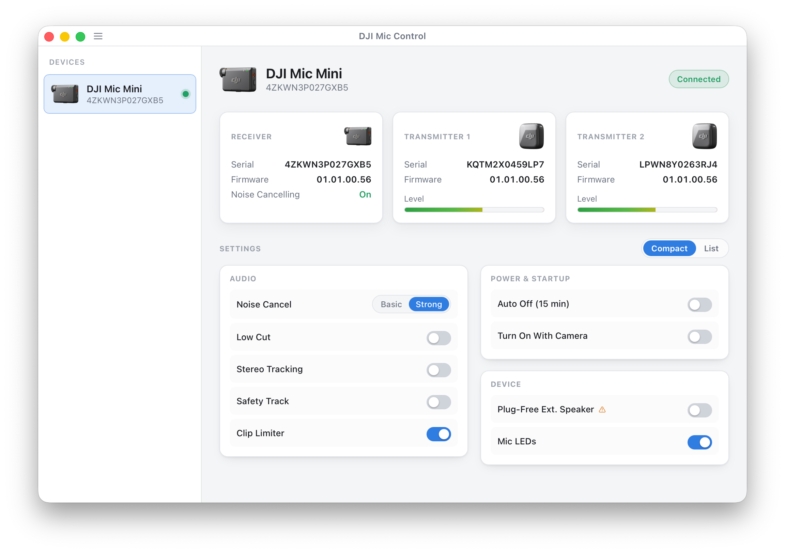
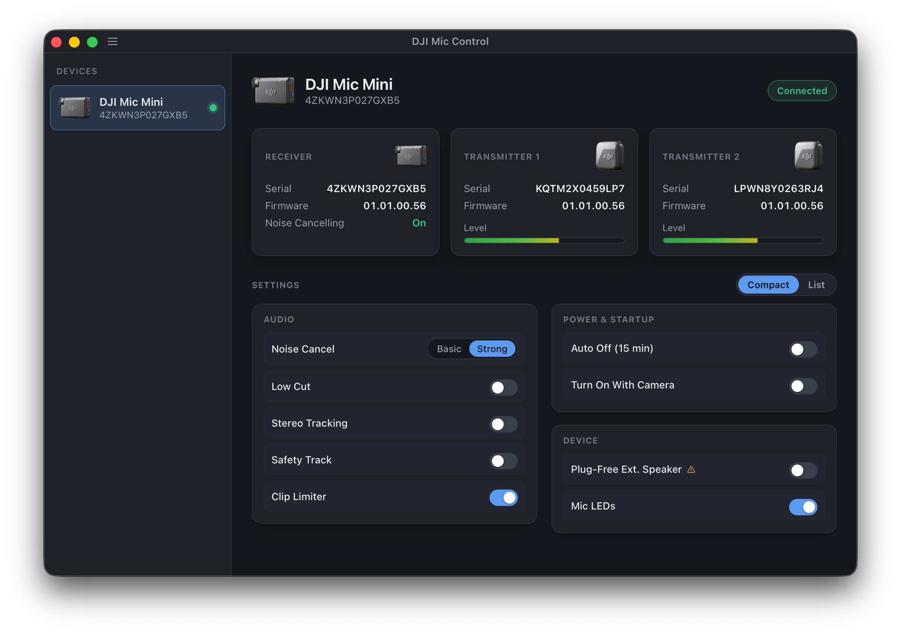

# DJI Mic Control




Cross-platform control for DJI wireless microphones over USB — a desktop GUI, a
command-line tool, and the shared Rust library behind both. No mobile app
required.

- **GUI** — a native app (Windows, macOS, Linux) with a hidable device sidebar,
  live status, audio meters, and every setting as a control.
- **CLI** — `djimic` for scripting and one-shot `get`/`set`.
- **Library** — a protocol crate and a device crate you can build on.

The wire protocol is documented in [PROTOCOL.md](PROTOCOL.md).

## Layout

```
crates/protocol   Framing, CRC, commands, heartbeat decoding, per-model settings
crates/device     USB transport (nusb) + multi-device manager, platform helpers
crates/cli        `djimic` command-line tool
gui               Tauri v2 app (Rust backend in src-tauri, Svelte frontend)
packaging         Linux udev rule shipped in the .deb/.rpm
```

Adding a setting means editing one model definition in `crates/protocol`; both
the CLI and GUI pick it up automatically. Adding a new microphone means
implementing the `DeviceModel` trait and registering it.

## Prerequisites

- Rust (1.77+) and Cargo.
- Node.js 18+ and npm (for the GUI frontend).
- The Tauri CLI: `cargo install tauri-cli` (or use `npx tauri`).
- **Linux** additionally needs the WebKitGTK / GTK development packages Tauri
  requires (e.g. `webkit2gtk-4.1`, `libgtk-3-dev`, `libayatana-appindicator3`,
  `librsvg2`), plus `nsis`/`rpmbuild` etc. only when producing those bundles.

## Build & run

CLI:

```
cargo run -p cli -- list
cargo run -p cli -- status
cargo run -p cli -- set noise-cancel strong
```

GUI (dev):

```
cd gui && npm install
cargo tauri dev            # from gui/, or: cargo tauri dev --config gui/src-tauri/tauri.conf.json
```

Run the tests:

```
cargo test
```

## Packaging

The GUI is the shipped product. From `gui/`:

```
RUSTFLAGS="--remap-path-prefix=${CARGO_HOME:-$HOME/.cargo}/= --remap-path-prefix=$HOME/=/" cargo tauri build
```

produces, per platform:

| Platform | Artifacts                        |
| -------- | -------------------------------- |
| macOS    | `.app`, `.dmg`                   |
| Windows  | `.exe` installer (NSIS)          |
| Linux    | `.deb`, `.rpm`, `.AppImage`      |

Build on each target OS to produce that OS's bundles. The `.deb` and `.rpm`
install the udev rule (`packaging/60-dji-mic.rules`) automatically.

The CLI builds the same way:
`RUSTFLAGS="--remap-path-prefix=${CARGO_HOME:-$HOME/.cargo}/= --remap-path-prefix=$HOME/=/" cargo build -p cli --release`
→ `target/release/djimic`.

The `RUSTFLAGS` remap is **mandatory** for any binary you ship: Rust bakes the
absolute source path of every crate into panic-message and backtrace strings,
which `strip` does *not* remove, so without this a crash would leak the build
machine's home directory (username, hostname). The remap keys off `$HOME` and
`$CARGO_HOME`, not the current directory, so it works from any build location;
the first prefix also covers CI hosts that relocate `CARGO_HOME` outside
`$HOME`. It also keeps release builds reproducible and independent of the build
machine's paths. On a headless build host (no FUSE), prepend
`APPIMAGE_EXTRACT_AND_RUN=1` so the AppImage tooling runs by extraction rather
than mounting.

## Linux USB access

Non-root USB access needs a udev rule. The `.deb`/`.rpm` install it for you;
otherwise, or when running from source, install it manually:

```
sudo cp packaging/60-dji-mic.rules /etc/udev/rules.d/
sudo udevadm control --reload-rules && sudo udevadm trigger
# then replug the receiver
```

The GUI detects a connected-but-inaccessible device and shows these steps in
an in-app helper.

## License

Released into the public domain under [The Unlicense](LICENSE). Do anything you
like with it — no attribution required.

Third-party dependencies keep their own (permissive) licenses; their notices are
included automatically in distributed binaries.
