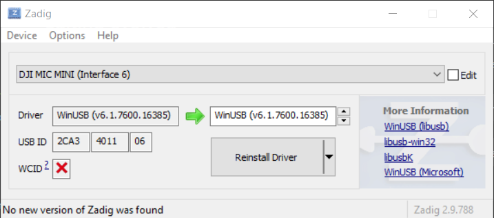

# DJI Mic Control


Cross-platform control for DJI wireless microphones over USB — a desktop GUI, a
command-line tool, and the shared Rust library behind both. No mobile app
required.

- **GUI** — a native app (Windows, macOS, Linux) with a hidable device sidebar,
  live status, audio meters, and every setting as a control.
- **CLI** — `djimic` for scripting and one-shot `get`/`set`.
- **Library** — a protocol crate and a device crate you can build on.

The wire protocol is documented in [PROTOCOL.md](PROTOCOL.md).

## macOS "DJI Mic Control.app is damaged and can't be opened"

macOS's security "gatekeeper" does not like that this app is not signed with an Apple developer account. Unfortunately, this means macOS will refuse to open an app downloaded unless you release it from quarantine.

After copying the app from the dmg to Applications, execute the following command to clear the quarantine flag:
```bash
sudo xattr -rd com.apple.quarantine /Applications/DJI\ Mic\ Control.app
```

## Side button remapping (macOS)

The receiver's side button normally acts as Volume Up. On macOS the GUI can
turn it into any keyboard shortcut instead — for example **Control + F18** to
start/stop hands-free dictation in Wispr Flow. It's set **per receiver**: select
the receiver, switch on **Remap side button** in its **Side Button** settings
group, then pick modifiers and a key (or click **Record** and press the
combination). Each receiver keeps its own setting; receivers left off keep
Volume Up.

- It needs **Input Monitoring** (to read the button) and **Accessibility** (to
  send the shortcut); the Side Button group shows what's missing and links to System
  Settings. Because the app isn't Developer-ID signed, macOS may ask again
  after an update.
- While enabled, the app holds that receiver's button interface exclusively;
  switching it off or quitting gives Volume Up back. Audio is unaffected.
- Don't run the standalone [`dji-mic`](https://github.com/TongkunZhang/dji-mic)
  service at the same time — only one app can hold the button.
- Settings are saved per receiver to `side-button.json` in the app's config
  directory, and reapplied whenever that receiver is plugged in.

Ported from [`TongkunZhang/dji-mic`](https://github.com/TongkunZhang/dji-mic),
itself inspired by Jonni Lundy's
[dictate-dji](https://github.com/jonnilundy/dictate-dji).

## Windows USB access

Windows binds the receiver's HID interface to its own class driver, and unlike
Linux/macOS, user-mode code cannot detach and claim that interface at runtime —
only an interface bound to WinUSB (or libusbK) can be opened. To fix this issue, use [Zadig](https://zadig.akeo.ie/) to replace the
driver on the receiver's HID interface `Interface 6` with WinUSB, then replug the receiver.



## Linux USB access

Non-root USB access needs a udev rule. The `.deb`/`.rpm` install it for you;
otherwise, or when running from source, install it manually:

```
sudo cp packaging/60-dji-mic.rules /etc/udev/rules.d/
sudo udevadm control --reload-rules && sudo udevadm trigger
# then replug the receiver
```

The GUI detects a connected-but-inaccessible device and shows these steps in
an in-app helper.

## Layout

```
crates/protocol   Framing, CRC, commands, heartbeat decoding, per-model settings
crates/device     USB transport (nusb) + multi-device manager, platform helpers
crates/cli        `djimic` command-line tool
crates/remap      Side-button → keyboard shortcut remapping (macOS)
gui               Tauri v2 app (Rust backend in src-tauri, Svelte frontend)
packaging         Linux udev rule shipped in the .deb/.rpm
```

Adding a setting means editing one model definition in `crates/protocol`; both
the CLI and GUI pick it up automatically. Adding a new microphone means
implementing the `DeviceModel` trait and registering it.

## Prerequisites

- Rust (1.77+) and Cargo.
- Node.js 18+ and npm (for the GUI frontend). `npm install` in `gui/` pulls in
  the Tauri CLI (`@tauri-apps/cli`) as a dev dependency — no separate
  `cargo install tauri-cli` needed, and no global install to keep in sync
  with the project's pinned Tauri version.
- **Linux** additionally needs the WebKitGTK / GTK development packages Tauri
  requires (e.g. `webkit2gtk-4.1`, `libgtk-3-dev`, `libayatana-appindicator3`,
  `librsvg2`), plus `nsis`/`rpmbuild` etc. only when producing those bundles.

## Build & run

CLI:

```
cargo run -p cli -- list
cargo run -p cli -- status
cargo run -p cli -- set noise-cancel strong
```

GUI (dev), from `gui/`:

```
npm install
npm run tauri dev      # or: npx tauri dev
```

Always launch the GUI through `tauri dev` (one of the forms above), never
`cargo run -p djimic-gui` / `cargo build -p djimic-gui` + running the binary
directly. A debug build loads its frontend from the Vite dev server
(`http://localhost:5173`) instead of the bundled files, and only `tauri dev`
actually starts that dev server for you — running the binary on its own
tries to reach a server that was never started, and the window comes up
blank/white with no content.

To just **run a working build** without developing (e.g. to check something
quickly), don't use a debug build at all — do a release build instead (see
[Packaging](#packaging) below), which embeds the frontend directly and has no
dependency on the dev server:

```
./build-release.sh                      # macOS/Linux; see build-release.ps1 on Windows
open "Release/macos/DJI Mic Control.app" # or the equivalent .deb/.rpm/.AppImage/.exe
```

Run the tests:

```
cargo test
```

## Packaging

The GUI is the shipped product. Use the release-build script at the repo
root — it sets the mandatory path-privacy `RUSTFLAGS` (see below), builds,
collects the artifacts into `Release/<os>/`, and verifies nothing leaked:

```
./build-release.sh          # macOS/Linux
./build-release.ps1         # Windows (PowerShell)
```

produces, per platform:

| Platform | Artifacts                                         |
| -------- | ------------------------------------------------- |
| macOS    | `.app`, `.dmg`                                    |
| Windows  | `.exe` portable, `.exe` installer (NSIS)          |
| Linux    | `.deb`, `.rpm`, `.AppImage`                       |

Build on each target OS to produce that OS's bundles. The `.deb` and `.rpm`
install the udev rule (`packaging/60-dji-mic.rules`) automatically.

Equivalent to running, by hand, from `gui/` (after `npm install`):

```
RUSTFLAGS="--remap-path-prefix=${CARGO_HOME:-$HOME/.cargo}/= --remap-path-prefix=$HOME/=/" npx tauri build
```

— the script is preferred since it also collects the artifacts and runs the
path-leak verification for you.

The CLI builds the same way:
`RUSTFLAGS="--remap-path-prefix=${CARGO_HOME:-$HOME/.cargo}/= --remap-path-prefix=$HOME/=/" cargo build -p cli --release`
→ `target/release/djimic`.

The `RUSTFLAGS` remap is **mandatory** for any binary you ship: Rust bakes the
absolute source path of every crate into panic-message and backtrace strings,
which `strip` does *not* remove, so without this a crash would leak the build
machine's home directory (username, hostname). The remap keys off `$HOME` and
`$CARGO_HOME`, not the current directory, so it works from any build location;
the first prefix also covers CI hosts that relocate `CARGO_HOME` outside
`$HOME`. It also keeps release builds reproducible and independent of the build
machine's paths. On a headless build host (no FUSE), prepend
`APPIMAGE_EXTRACT_AND_RUN=1` so the AppImage tooling runs by extraction rather
than mounting.

## License

Released into the public domain under [The Unlicense](LICENSE). Do anything you
like with it — no attribution required.

Third-party dependencies keep their own (permissive) licenses; their notices are
included automatically in distributed binaries.
